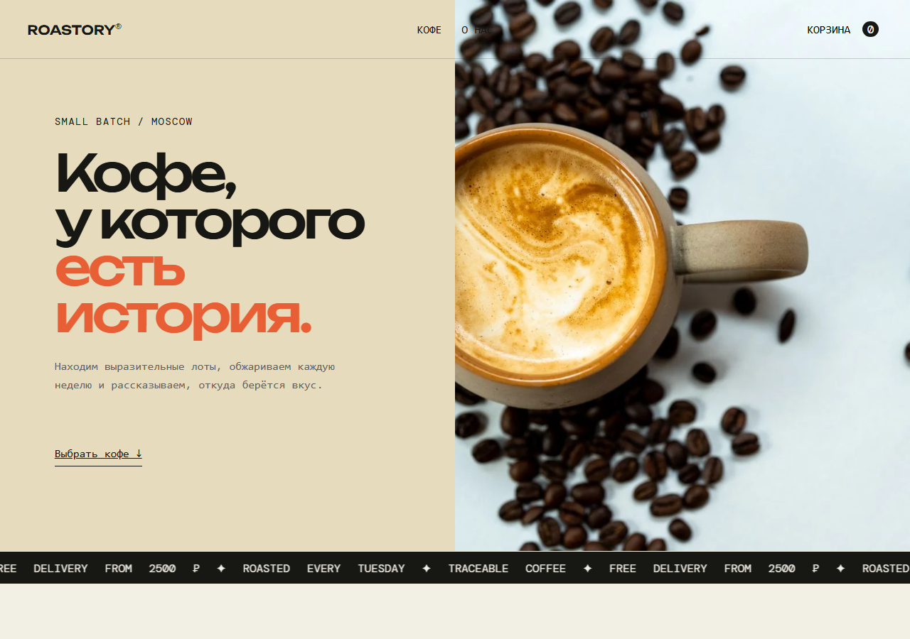
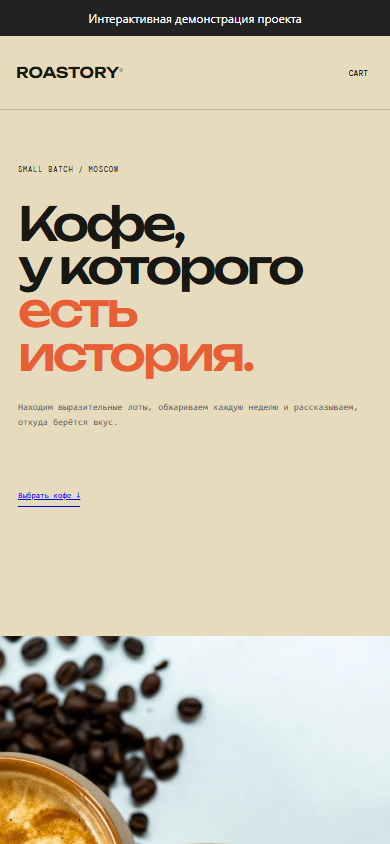

# Roastory - магазин свежеобжаренного кофе

Каталог кофейных лотов, корзина и оформление заказа с расчётом итоговой суммы на сервере.

[Открыть проект](https://memorim.github.io/roastory-coffee-shop/)





## Возможности

- Фильтрация кофе по обработке, выбор количества и корзина.
- Сохранение заказа и его позиций в SQLite или PostgreSQL.
- Фотографии кофе и обжарки, адаптивные карточки и локальные изображения.

## Стек и устройство

JavaScript, Express, Zod, SQLite для локального запуска, PostgreSQL для опубликованного сервера и HTML/CSS.

## Ключевые решения

- Цена загружается из серверного каталога. Заказ и его позиции сохраняются одной транзакцией.
- Параметры проходят серверную валидацию, ошибки JSON возвращают ограниченный ответ. По умолчанию API слушает loopback.
- Чтение цен и запись заказа находятся внутри `BEGIN IMMEDIATE`. Цены - целые рубли, допустимы значения 1-1 000 000; итог проверяется на безопасное целое. Клиентская цена игнорируется. В заказе до 50 разных лотов, по 1-10 единиц каждого.
- Необязательный `Idempotency-Key` сохраняет результат заказа: повтор с теми же данными возвращает прежний ID и сумму; другие данные с тем же ключом дают 409. Форма сохраняет ключ и корзину при сетевой ошибке.
- Ответ просмотра заказа содержит только ID, сумму, статус и дату; имя и email не возвращаются. Ошибки не пишут контакты в журнал.

## Локальный запуск

Node.js 24.18.0 и pnpm 11.7.0; версии закреплены в файлах проекта.

```bash
npm install --global pnpm@11.7.0
pnpm install --frozen-lockfile
pnpm start
```

Откройте `http://localhost:4500`. HOST ограничен loopback, API проверяет Host и Origin. Для разработки доступен `pnpm dev`.

## Настройки

Параметры перечислены в [.env.example](.env.example). `pnpm start` использует окружение процесса и не загружает файл автоматически. После копирования `.env` его можно загрузить явно: `node --env-file=.env server.js`.

## Данные и обновления

SQLite хранится в `data/roastory.db`. Транзакционное обновление добавляет nullable поля request_key/request_hash и уникальный индекс, сохраняя прежние заказы и позиции. Перед обновлением сохраните резервную копию; удалять БД вместо миграции не нужно.

## Проверки

```bash
pnpm test
pnpm test:contract
pnpm test:upgrade
pnpm audit --audit-level=high
pnpm exec playwright install --with-deps --only-shell chromium
pnpm test:e2e
```

Проверяются границы количества, дубли SKU, цена сервера, откат заказа и позиций, приватность ответа и две независимые серверные копии с одной SQLite и одним ключом. Upgrade сохраняет прежний заказ с позициями. Браузерные проверки покрывают каталог, корзину, повреждённое хранилище и потерю ответа. Playwright - только зависимость разработки, чтобы эти сценарии выполнялись в CI.

Браузерные проверки запускают отдельную SQLite в памяти и не используют обычную папку `data`.

CI устанавливает зависимости по зафиксированным версиям и запускает настроенные проверки. Отдельная проверка документации находит неверные локальные ссылки и изображения. Проверка уязвимостей учитывает известные проблемы на момент запуска.

## Правила тестового магазина

- Подключён тестовый магазин ЮKassa; создание платежа и серверная проверка статуса проверены на тестовом сервере. Успешная тестовая оплата и сохранение заказа после перезапуска подтверждены [сквозной проверкой](docs/LIVE_PAYMENT_2026_11_11.md). Реальные платежи запрещены; доставка исключена из задачи. Полноценные аккаунты покупателей не реализованы, доступ к заказу предоставляется по индивидуальному ключу.
- Публичный режим требует HTTPS и ключ владельца; кабинет владельца защищён, покупатель читает только заказ со своим ключом. Опубликованный тестовый сервер использует постоянный PostgreSQL. JSON ограничен 16 КБ; 20 попыток заказа в минуту сохраняются в SQLite и разделяются процессами.
- Клиенты без Idempotency-Key по совместимости создают новый заказ на каждый POST. Контакты автоматически обезличиваются через CONTACT_RETENTION_DAYS (90 дней по умолчанию, проверка раз в час при API-запросах); остатки проверяются и списываются атомарно. Стоимость фиксируется при создании заказа; интерфейсная сумма предварительная.

## Документация

[Результаты аудита](docs/AUDIT_2026_10.md) · [Техническая документация](docs/TECHNICAL.md) · [Пример запроса и ответа](docs/API_EXAMPLE.md) · [История изменений](CHANGELOG.md)

## Версия в браузере

Открывается без установки. Изменения изолированы в памяти текущей вкладки и сбрасываются при перезагрузке. Серверные гарантии и SQLite относятся к локальному запуску, описанному выше.

Сборка: `python scripts/build_demo.py`. Проверка адаптера: `node --test demo/demo.test.mjs`.

### Устойчивые ограничения запросов

Бюджеты попыток сохраняются в выбранной БД (SQLite или PostgreSQL) и разделяются всеми процессами, использующими одну БД. Перезапуск сервера не сбрасывает лимиты. Ответ 429 содержит Retry-After. Для нескольких узлов задайте общий PostgreSQL через DATABASE_URL.

### Остатки

Заказ атомарно уменьшает products.stock; при нехватке любого товара откатывается весь заказ. Повтор с тем же ключом не списывает остаток повторно. В новой демонстрационной БД остаток каждого товара — 100. В существующей БД он остаётся NULL до инвентаризации: заказы таких товаров возвращают 409. Оператор задаёт подтверждённые значения в БД до запуска продаж.

### Заказы покупателя и управление складом

Заказ возвращает accessKey. Просмотр требует X-Order-Key: этот ключ; перебор номера заказа не даёт доступа. Интерфейс хранит ключи последних 50 заказов в браузере и позволяет обновить статусы. Не публикуйте ключи и не передавайте их в URL.

Владелец задаёт APP_OWNER_TOKEN (случайный секрет от 32 символов). GET /api/owner/orders и PATCH /api/owner/products/:id/stock требуют Authorization: Bearer. Изменение остатков передаёт stock и expectedStock; устаревшее значение возвращает 409. Для публичного режима задайте APP_PUBLIC_ORIGIN=https://... и TLS-прокси. Старые заказы без ключа доступны владельцу. Доставка исключена из текущего задания.

### Тестовые платежи ЮKassa

Задайте YOOKASSA_SHOP_ID, YOOKASSA_SECRET_KEY (только test_...) и PAYMENT_RETURN_URL (HTTPS). Покупатель создаёт тестовый платёж из «Мои заказы». Сумма берётся из серверного заказа; ключ идемпотентности сохраняется в SQLite. Статус paid устанавливается только после запроса сервером состояния платежа и проверки test, paid, суммы, валюты и связи с заказом. Возврат со страницы оплаты сам по себе заказ не оплачивает. Для тестового магазина добавлен отдельный `POST /api/orders/:id/payment/cancel`: он проверяет отмену через API ЮKassa, переводит заказ в `canceled` и возвращает остатки на склад один раз. Обновление статуса также освобождает остатки при подтверждённой провайдером отмене. Для redirect-платежа запрос отмены отправляется только из waiting_for_capture с устойчивым ключом идемпотентности; pending возвращает 409 без изменения остатков. После неопределённого результата старше 23 часов требуется сверка, новый платёж автоматически не создаётся. Рабочие ключи запрещены этим адаптером.


### Кабинет владельца

При серверном запуске откройте `/owner.html`: заказы и остатки. Вход по `APP_OWNER_TOKEN`; ключ не сохраняется в localStorage или URL и удаляется при выходе. На GitHub Pages кабинет не подключён к серверной базе.

[Результат проверки тестового сервера](docs/TEST_DEPLOYMENT.md).

### Постоянное хранилище заказов

`ROASTORY_DATA_DIRECTORY` позволяет разместить SQLite на отдельном постоянном диске. [Порядок переноса и проверки после перезапуска](docs/PERSISTENT_STORAGE.md) сохраняет заказы, остатки и ключи повторов платежей. Подключение самого диска выполняется в настройках хостинга; опубликованный Free-сервис использует отдельный PostgreSQL, поэтому постоянный диск ему не требуется.


## Размещение и снимки — 08.11.2026

Тестовый Render-сервис использует постоянный PostgreSQL в отдельном Neon-проекте: https://memorim-roastory-test.onrender.com/. Добавлен серверный сценарий отмены тестового платежа с восстановлением остатков. Успешная тестовая оплата через ЮMoney, возврат на сайт, серверная сверка succeeded и сохранность оплаченного заказа после перезапуска проверены 11.11.2026. [Протокол](docs/LIVE_PAYMENT_2026_11_11.md).

Визуальный интерфейс не менялся; desktop/mobile снимки выше остаются актуальными и должны обновляться при следующем изменении UI.
