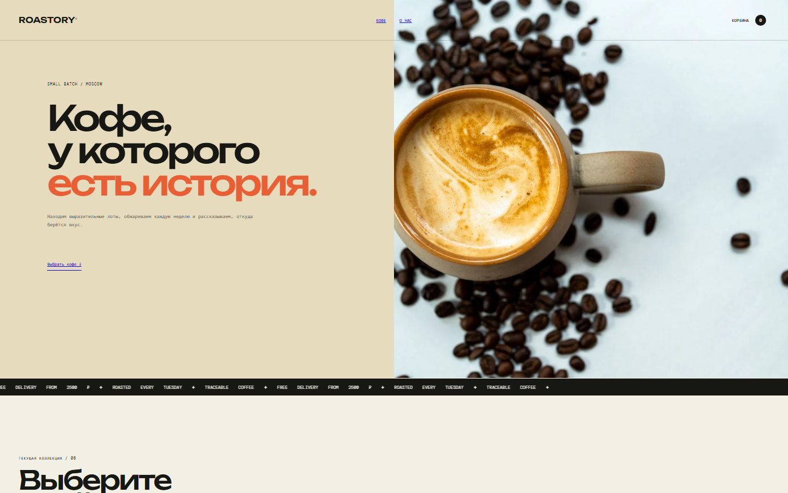
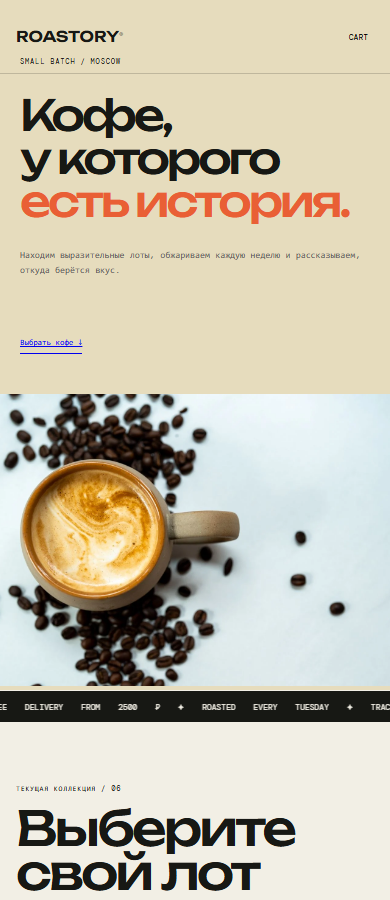

# Roastory - магазин свежеобжаренного кофе

Каталог кофейных лотов, корзина и оформление заказа с расчётом итоговой суммы на сервере.

[Открыть проект](https://memorim.github.io/roastory-coffee-shop/)





## Возможности

- Фильтрация кофе по обработке, выбор количества и корзина.
- Сохранение заказа и его позиций в SQLite.
- Фотографии кофе и обжарки, адаптивные карточки и локальные изображения.

## Стек и устройство

JavaScript, Express, Zod, встроенный SQLite в Node.js и HTML/CSS.

## Ключевые решения

- Цена загружается из серверного каталога. Заказ и его позиции сохраняются одной транзакцией.
- Параметры проходят серверную валидацию, ошибки JSON возвращают ограниченный ответ. По умолчанию API слушает loopback.
- Чтение цен и запись заказа находятся внутри `BEGIN IMMEDIATE`. Цены - целые рубли, допустимы значения 1-1 000 000; итог проверяется на безопасное целое. Клиентская цена игнорируется. В заказе до 50 разных лотов, по 1-10 единиц каждого.
- Необязательный `Idempotency-Key` сохраняет результат заказа: повтор с теми же данными возвращает прежний ID и сумму; другие данные с тем же ключом дают 409. Форма сохраняет ключ и корзину при сетевой ошибке.
- Ответ просмотра заказа содержит только ID, сумму, статус и дату; имя и email не возвращаются. Ошибки не пишут контакты в журнал.

## Локальный запуск

Node.js 24.18.0 и pnpm 11.7.0; версии закреплены в файлах проекта.

```bash
npm install --global pnpm@11.7.0
pnpm install --frozen-lockfile
pnpm start
```

Откройте `http://localhost:4500`. HOST ограничен loopback, API проверяет Host и Origin. Для разработки доступен `pnpm dev`.

## Настройки

Параметры перечислены в [.env.example](.env.example). `pnpm start` использует окружение процесса и не загружает файл автоматически. После копирования `.env` его можно загрузить явно: `node --env-file=.env server.js`.

## Данные и обновления

SQLite хранится в `data/roastory.db`. Транзакционное обновление добавляет nullable поля request_key/request_hash и уникальный индекс, сохраняя прежние заказы и позиции. Перед обновлением сохраните резервную копию; удалять БД вместо миграции не нужно.

## Проверки

```bash
pnpm test
pnpm test:contract
pnpm test:upgrade
pnpm audit --audit-level=high
pnpm exec playwright install --with-deps --only-shell chromium
pnpm test:e2e
```

Проверяются границы количества, дубли SKU, цена сервера, откат заказа и позиций, приватность ответа и две независимые серверные копии с одной SQLite и одним ключом. Upgrade сохраняет прежний заказ с позициями. Браузерные проверки покрывают каталог, корзину, повреждённое хранилище и потерю ответа. Playwright - только зависимость разработки, чтобы эти сценарии выполнялись в CI.

Браузерные проверки запускают отдельную SQLite в памяти и не используют обычную папку `data`.

CI устанавливает зависимости по зафиксированным версиям и запускает настроенные проверки. Отдельная проверка документации находит неверные локальные ссылки и изображения. Проверка уязвимостей учитывает известные проблемы на момент запуска.

## Ограничения

- Платежи, доставка и аккаунты покупателей не подключены.
- Это локальное приложение без аккаунтов. Публичный сбор заказов требует отдельной авторизации и контроля хранения контактов. JSON ограничен 16 КБ; 20 попыток заказа в минуту считаются в памяти одного процесса и сбрасываются после перезапуска.
- Клиенты без Idempotency-Key по совместимости создают новый заказ на каждый POST. Автоматической очистки контактов и контроля складских остатков нет. Стоимость фиксируется при создании заказа; интерфейсная сумма предварительная.

## Документация

[Результаты аудита](docs/AUDIT_2026_10.md) · [Техническая документация](docs/TECHNICAL.md) · [Пример запроса и ответа](docs/API_EXAMPLE.md) · [История изменений](CHANGELOG.md)

## Версия в браузере

Открывается без установки. Изменения изолированы в памяти текущей вкладки и сбрасываются при перезагрузке. Серверные гарантии и SQLite относятся к локальному запуску, описанному выше.

Сборка: `python scripts/build_demo.py`. Проверка адаптера: `node --test demo/demo.test.mjs`.
